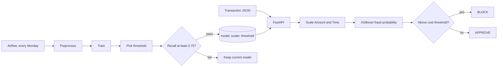
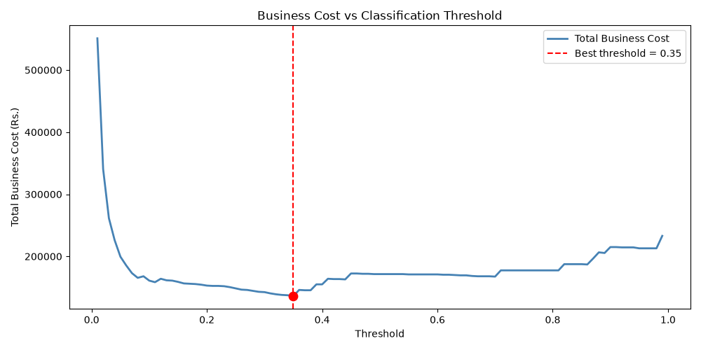

# Credit Card Fraud Detection

[](https://github.com/Siddhesh-Ai9797/fraud-churn-detection/actions/workflows/ci.yml)

A real time fraud scoring API built on the Kaggle credit card dataset, where only 0.17% of transactions are fraud. It compares SVM kernels and imbalance strategies, then picks a decision threshold by real business cost instead of the default 0.5. The model is served with FastAPI, retrained weekly by Airflow, and scaled on Kubernetes.

## Results

| Metric | Value |
|---|---|
| XGBoost with class weighting | **0.88** fraud precision, **0.85** fraud recall |
| Best SVM kernel by AUC | RBF at **0.964**, linear at 0.928 |
| Cost optimized threshold | Catches **88%** of fraud at the lowest total cost |
| Dataset | 284,807 transactions, 492 frauds |

All numbers come from the test split of 56,962 transactions with 98 frauds.

## How it works



1. **Score.** The API takes the 28 anonymized features plus Amount and Time, scales Amount and Time, and gets a fraud probability from XGBoost.
2. **Decide.** It blocks the transaction when the probability passes the saved business threshold.
3. **Retrain.** Every Monday at 2am, Airflow preprocesses the data, retrains, and sweeps thresholds again.
4. **Guard.** A new model ships only if its fraud recall is at least 0.75. Otherwise the pipeline stops and the current model stays.
5. **Scale.** Kubernetes runs 2 pods and scales up to 10 when CPU passes 70%.

## Research findings

### 1. Linear or RBF kernel

SVMs with balanced class weights, trained on a 10,000 transaction sample:

| Kernel | AUC | Fraud precision | Fraud recall |
|---|---|---|---|
| Linear | 0.928 | 0.78 | 0.74 |
| RBF | **0.964** | 0.70 | 0.41 |

RBF ranks transactions better, so fraud is not cleanly separable by a straight line. But at the default 0.5 threshold, RBF caught far fewer frauds. A better ranking is only useful once the threshold is tuned, which is what finding 3 does.

### 2. SMOTE or class weighting

The training split has 394 frauds against 227,451 normal transactions, a ratio of about 577 to 1.

| Strategy | Fraud precision | Fraud recall | F1 |
|---|---|---|---|
| **Class weighting** | **0.88** | 0.85 | **0.86** |
| SMOTE | 0.73 | **0.89** | 0.80 |

SMOTE created about 227,000 synthetic fraud rows and caught slightly more fraud, but it blocked many more innocent customers. Class weighting tells XGBoost that missing a fraud costs 577 times more, needs no synthetic data, and gave the best F1. I chose class weighting.

### 3. Threshold by business cost

I assumed a missed fraud costs ₹10,000 and a false alarm costs ₹500. The default 0.5 threshold treats both mistakes as equal. Missing fraud is 20 times more expensive, so the threshold should be much lower.

Sweeping every threshold from 0.01 to 0.99 in the analysis notebook gave a best threshold of 0.03. It caught 88% of frauds with 0.69 precision, for a total cost of ₹139,500 on the test split. The training pipeline repeats this sweep after every retrain and saves the result to `outputs/threshold.txt`, which the API reads at startup.



## Tech stack

| Area | Tools |
|---|---|
| Modeling | XGBoost, scikit-learn SVM, imbalanced-learn |
| Serving | FastAPI, Docker |
| MLOps | Airflow, MLflow, Kubernetes with autoscaling, GitHub Actions |

## Project structure

```
src/
  preprocess.py       Load, scale, split and save the scalers
  train.py            XGBoost with class weighting, logged to MLflow
  evaluate.py         Threshold sweep by business cost
api/main.py           FastAPI scoring service
dags/                 Weekly Airflow retraining with a recall check
k8s/                  Deployment, service and autoscaler, 2 to 10 pods
notebooks/            SVM kernels, imbalance and threshold analysis
outputs/              Model, scaler and threshold used by the API
tests/                API, threshold and scaling tests
```

## Running it

```bash
pip install -r requirements.txt
uvicorn api.main:app --reload
```

| Endpoint | Returns |
|---|---|
| `POST /predict` | BLOCK or APPROVE, fraud probability and threshold |
| `POST /predict/batch` | One decision per transaction |
| `GET /model/info` | Threshold and cost settings |
| `GET /health` | Service status |

To retrain from scratch, download [creditcard.csv](https://www.kaggle.com/datasets/mlg-ulb/creditcardfraud) into `data/`, then:

```bash
python src/preprocess.py
python src/train.py
python src/evaluate.py
```

In Docker:

```bash
docker build -t fraud-detection .
docker run -p 8000:8000 fraud-detection
```

On Kubernetes:

```bash
kubectl apply -f k8s/
```

## Tests

```bash
pip install -r requirements.txt pytest httpx
python -m pytest -q
```

The tests cover the prediction and batch endpoints, threshold logic, input checks, and per column scaling. GitHub Actions runs them on every push, then builds the Docker image and checks that `/health` responds.

## Author

Siddhesh Patil, MS in Artificial Intelligence, DePaul University
