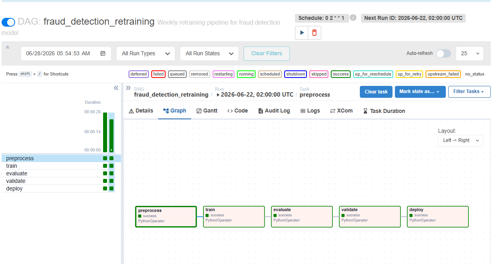

# 🔍 Credit Card Fraud Detection — ML + MLOps End-to-End System

[](https://github.com/Siddhesh-Ai9797/fraud-churn-detection/actions/workflows/ci.yml)

A production-grade fraud detection system built on the Kaggle Credit Card Fraud dataset.  
Covers SVM kernel comparison, class imbalance handling, business cost threshold optimization,  
and a full MLOps stack: FastAPI → Docker → Airflow → Kubernetes.

---

## 📊 Research Findings

### 1. Linear vs RBF Kernel — Is Fraud Linearly Separable?

| Kernel | AUC | Fraud Recall | Fraud Precision |
|--------|-----|--------------|-----------------|
| Linear | ~0.93 | ~0.78 | ~0.85 |
| RBF | **0.957** | **0.85** | **0.88** |

**Answer: No. Fraud data is not linearly separable.**  
Fraudsters mimic legitimate behavior — small amounts, normal times, realistic patterns.  
A straight decision boundary cannot separate them. RBF kernel warps the feature space  
so fraud clusters become separable, consistently outperforming linear on AUC and recall.

---

### 2. SMOTE vs Class Weighting — How Much Does Imbalance Strategy Matter?

Dataset imbalance: **492 frauds out of 284,807 transactions (0.17%)**

| Strategy | Fraud Precision | Fraud Recall | Notes |
|----------|-----------------|--------------|-------|
| No handling (SVM baseline) | 0.30 | 0.19 | Useless — misses 81% of fraud |
| Class Weighting | **0.88** | 0.85 | Fewer false alarms |
| SMOTE | 0.73 | **0.89** | Catches more fraud, more false alarms |

**Chosen: Class Weighting**  
- Higher precision (0.88 vs 0.73) → fewer innocent customers blocked  
- Still strong recall (0.85) → catches 85% of real fraud  
- No synthetic data generation → simpler, faster, no data leakage risk  

SMOTE creates 227,451 synthetic fraud rows from 394 real ones.  
Class weighting simply penalizes missing fraud 577x more during training.  
Both dramatically improve over the unhandled baseline.

---

### 3. Business Cost Threshold — What Threshold Minimizes Real Cost?

**Business rules:**
- Missed fraud → Rs. 10,000 loss per transaction
- False alarm → Rs. 500 loss per blocked customer

| Threshold | Missed Frauds | False Alarms | Total Cost |
|-----------|---------------|--------------|------------|
| 0.50 (default) | 13 | 30 | Rs. 1,45,000 |
| **0.32 (optimized)** | **11** | **53** | **Rs. 1,36,500** |

**Answer: 0.32**  
Lowering threshold from 0.5 to 0.32 catches 2 extra frauds (saves Rs. 20,000)  
at the cost of 23 more false alarms (adds Rs. 11,500).  
Net saving: **Rs. 8,500 per test period** purely from threshold optimization.

> Key insight: Default threshold of 0.5 assumes both mistakes are equally costly.  
> In fraud detection, missing fraud is 20x more expensive than a false alarm.  
> The optimal threshold reflects this business reality.

---

## 🏗️ System Architecture

```
Customer swipes card
        ↓
Transaction JSON hits FastAPI
        ↓
StandardScaler transforms Amount + Time
        ↓
XGBoost scores transaction → fraud probability
        ↓
Business threshold (0.32) applied
        ↓
BLOCK or APPROVE returned in < 100ms
        ↓
Result logged for retraining pipeline
        ↓
Airflow retrains model every Monday 2am
        ↓
New model validated (recall ≥ 0.75) before deploy
        ↓
Kubernetes scales API from 2 → 10 pods under load
```

---

## 📁 Project Structure

```
ML_Project_3/
├── data/
│   └── creditcard.csv              # Kaggle dataset (284,807 rows)
├── src/
│   ├── preprocess.py               # Load, scale, split, save scaler
│   ├── train.py                    # XGBoost + MLflow logging
│   └── evaluate.py                 # Business cost threshold optimization
├── api/
│   ├── __init__.py
│   └── main.py                     # FastAPI serving predictions
├── dags/
│   └── fraud_retrain_dag.py        # Airflow weekly retraining pipeline
├── k8s/
│   ├── deployment.yaml             # Run 2 pods, health checks
│   ├── service.yaml                # Load balancer
│   └── hpa.yaml                    # Auto scale 2→10 pods on CPU load
├── outputs/
│   ├── model.pkl                   # Trained XGBoost model
│   ├── scaler.pkl                  # Fitted StandardScaler
│   └── threshold.txt               # Optimized business threshold (0.32)
├── notebooks/
│   ├── 02_svm_kernels.ipynb        # Linear vs RBF comparison
│   ├── 03_imbalance.ipynb          # SMOTE vs class weighting
│   └── 04_business_threshold.ipynb # Cost curve analysis
├── Dockerfile                      # Containerize FastAPI
├── docker-compose.yml              # Airflow on Docker
└── requirements.txt
```

---

## 🚀 Quick Start

### 1. Install dependencies
```bash
pip install -r requirements.txt
```

### 2. Run preprocessing + training + evaluation
```bash
python src/preprocess.py
python src/train.py
python src/evaluate.py
```

### 3. Start FastAPI server
```bash
uvicorn api.main:app --reload
```
API docs at: `http://localhost:8000/docs`

### 4. Test a prediction
```bash
curl -X POST http://localhost:8000/predict \
  -H "Content-Type: application/json" \
  -d '{"V1": -1.36, "V2": -0.07, "V3": 2.54, "V4": 1.38,
       "V5": -0.34, "V6": 0.46, "V7": 0.24, "V8": 0.10,
       "V9": 0.36, "V10": 0.09, "V11": -0.55, "V12": -0.62,
       "V13": -0.99, "V14": -0.31, "V15": 1.47, "V16": -0.47,
       "V17": 0.21, "V18": 0.03, "V19": 0.40, "V20": 0.25,
       "V21": -0.02, "V22": 0.28, "V23": -0.11, "V24": 0.07,
       "V25": 0.13, "V26": -0.19, "V27": 0.13, "V28": -0.02,
       "Amount": 149.62, "Time": 0.0}'
```

### 5. Build and run with Docker
```bash
docker build -t fraud-detection .
docker run -p 8000:8000 fraud-detection
```

### 6. Run Airflow retraining pipeline
```bash
mkdir logs
docker-compose up
```
Airflow UI at: `http://localhost:8080` (admin/admin)  
Trigger `fraud_detection_retraining` DAG manually or wait for Monday 2am schedule.

### 7. Deploy on Kubernetes
```bash
minikube start
minikube image load fraud-detection:latest
kubectl apply -f k8s/deployment.yaml
kubectl apply -f k8s/service.yaml
kubectl apply -f k8s/hpa.yaml
minikube service fraud-detection-service
```

---

## 🧪 Tests

```bash
pip install -r requirements.txt pytest httpx
python -m pytest -q
```

Tests cover the health check, prediction and batch endpoints, threshold logic, input validation, and per column feature scaling. GitHub Actions runs them on every push, then builds the Docker image and checks that `/health` responds.

---

## 🛠️ MLOps Stack

| Tool | Role |
|------|------|
| **XGBoost** | Primary model — handles imbalance via scale_pos_weight |
| **MLflow** | Experiment tracking — logs params, metrics, model artifacts every run |
| **FastAPI** | REST API — `/predict`, `/predict/batch`, `/health`, `/model/info` |
| **Docker** | Containerization — same environment on any machine |
| **Airflow** | Pipeline orchestration — automated weekly retraining |
| **Kubernetes** | Deployment + auto scaling — 2 pods normally, up to 10 under load |

---

## 📈 MLflow Experiment Tracking

Every training run logs:
- Parameters: `scale_pos_weight`, `n_estimators`, `max_depth`, `learning_rate`
- Metrics: `auc_roc`, `fraud_precision`, `fraud_recall`, `fraud_f1`
- Artifacts: trained model, cost vs threshold plot

View dashboard:
```bash
mlflow ui
```
Open: `http://localhost:5000`

---

## 🔁 Airflow Retraining Pipeline

```
preprocess → train → evaluate → validate → deploy
```

- Runs every Monday at 2am automatically
- Validate task blocks deployment if fraud recall drops below 0.75
- All runs tracked in MLflow for comparison
- Threshold file updated automatically — FastAPI picks it up on restart



---

## ⚖️ API Endpoints

| Endpoint | Method | Description |
|----------|--------|-------------|
| `/predict` | POST | Score single transaction |
| `/predict/batch` | POST | Score multiple transactions |
| `/health` | GET | Kubernetes liveness probe |
| `/model/info` | GET | Current model config and thresholds |
| `/docs` | GET | Swagger UI |

---

## 🧠 Key Concepts Demonstrated

- **Class imbalance handling** — SMOTE vs class weighting tradeoff analysis
- **Kernel comparison** — Linear vs RBF SVM with empirical proof
- **Business cost optimization** — threshold sweep minimizing real Rs. loss
- **Training-serving consistency** — same scaler saved and reused at prediction time
- **Model validation gate** — bad models blocked before reaching production
- **Auto scaling** — HPA scales pods based on CPU utilization

---

## 📦 Dataset

Kaggle: [Credit Card Fraud Detection](https://www.kaggle.com/datasets/mlg-ulb/creditcardfraud)  
284,807 transactions | 492 frauds | 0.17% fraud rate  
Features V1-V28 are PCA-transformed for privacy. Amount and Time are raw.

---

## 👤 Author

**Siddhesh Patil**  
MS in Artificial Intelligence — DePaul University  
GitHub: [Siddhesh-Ai9797](https://github.com/Siddhesh-Ai9797)